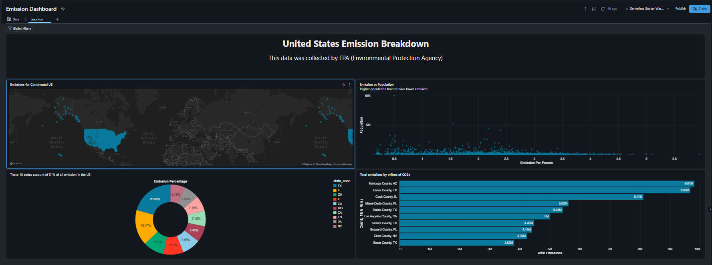

# United States Greenhouse Gas Emissions Dashboard

## 📖 Overview

This Databricks project delivers a comprehensive, county-level breakdown of greenhouse gas (GHG) emissions across the United States. Utilizing data collected by the **Environmental Protection Agency (EPA)**, this dashboard serves as an emissions "atlas" designed to show *where* US emissions concentrate—both geographically and demographically—rather than just presenting raw national totals.

The dashboard is built from a robust county-level emissions table that covers population, energy consumption, and total emissions for every US county. By combining these metrics, the project makes it easy to spot the specific states and counties that drive half the nation's output.

## 🎯 Key Insights & Storytelling

The dashboard features four distinct visualizations that tell a cohesive story about US emissions:

1. **Geographic Distribution (US Map):** 
   * Displays one point per county across the continental US, highlighting regional hotspots and clusters of high emissions.
2. **The Urban vs. Rural Divide (Scatter Plot):** 
   * Plots county population against per-person emissions. 
   * **Key Finding:** The data reveals a negative correlation, highlighting that lower-population counties (often rural, industrial, and agricultural areas) tend to emit significantly more per capita than highly populated urban centers.
3. **State-Level Dominance (Donut Chart):** 
   * Breaks down emissions by state to identify the top contributors.
   * **Key Finding:** The top 10 states account for approximately **51% of all emissions** in the US, led by Texas and Florida.
4. **County-Level Hotspots (Bar Chart):** 
   * Ranks the highest-emitting individual counties (e.g., Maricopa County, AZ; Harris County, TX) measured in millions of metric tons of CO2-equivalent (CO2e).

## 📊 Data Source

* **Provider:** Environmental Protection Agency (EPA)
* **Granularity:** County-level (US)
* **Primary Metrics:** 
  * Total Greenhouse Gas Emissions (millions of metric tons of CO2e)
  * Emission Per Person
  * Population
* **Supplementary Data:** State abbreviations and regional mappings.

## 🛠️ Tech Stack

* **Platform:** Databricks (Serverless)
* **Data Processing:** PySpark / Spark SQL
* **Visualization:** Databricks SQL Dashboards / Lakeview
* **Storage:** Unity Catalog (Delta Tables)

## 🚀 Getting Started

### Prerequisites
* Access to a Databricks workspace.
* Permissions to create SQL Dashboards and query tables in Unity Catalog.

### Setup Instructions
1. **Data Ingestion:** Import the raw EPA county-level emissions dataset into your Databricks environment (e.g., a Unity Catalog Volume).
2. **Data Transformation:** Run the provided SQL/PySpark notebook to clean, aggregate, and join the population data with the emissions metrics. Save the output as a Delta Table.
3. **Dashboard Deployment:** 
   * Open the Databricks SQL workspace.
   * Create a new Dashboard.
   * Connect to the transformed Delta Table.
   * Recreate the four visualizations (Map, Scatter, Donut, Bar) using the metrics defined in the Data Source section.

## 💡 Use Cases

* **Policy & Regulation:** Helps environmental agencies and policymakers target interventions in the specific counties and industrial hubs driving the highest per-capita emissions.
* **Resource Allocation:** Informs the strategic distribution of environmental funding by identifying the 10 states responsible for over half the nation's emissions.
* **Public Awareness:** Provides a clear, visual representation of how emission profiles differ dramatically between urban and rural environments.

---
*Disclaimer: The data used in this dashboard is sourced from the Environmental Protection Agency (EPA) and is intended for analytical and educational purposes.*
